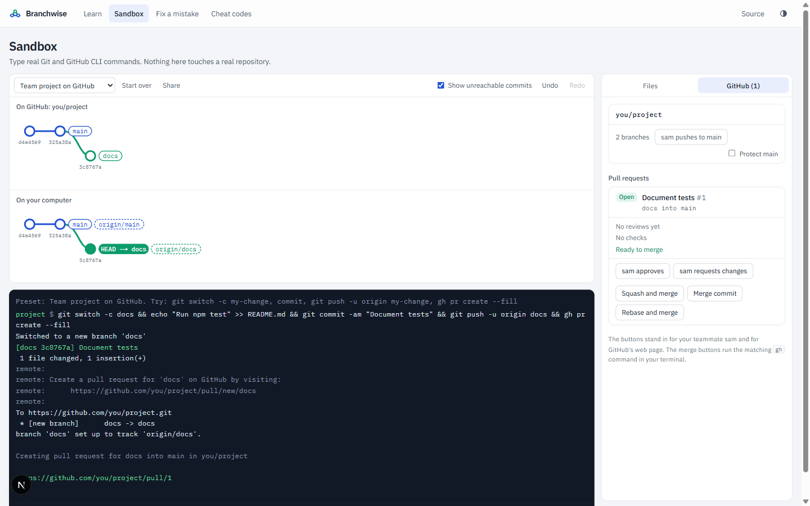

# Branchwise

**Learn Git and GitHub by watching every command move the commit graph.**

Branchwise draws a repository as a transit map: commits are stations, branches are coloured lines, `HEAD` is the filled station. You type real `git` and `gh` commands into a terminal and watch labels move, commits get copied by a rebase, and pushes travel up to a simulated GitHub and back.

It's free, needs no account, and nothing touches a real repository: everything runs in your browser.



## Four ways in

| Mode | What it is |
| --- | --- |
| **Learn** | 23 lessons in four modules: Git basics, branching and merging, collaborating on GitHub, and advanced Git (interactive rebase, cherry-pick, reflog, bisect, internals, submodules, GitHub Actions). Each step is *read*, *watch* (a scripted command animates) or *try* (a goal you reach yourself, checked against the repository's real state). |
| **Sandbox** | Free play with eight presets: an empty folder, two diverged branches, a merge conflict, a team repo on GitHub, a protected `main` with CI, an open-source fork, and a bisect bug hunt. Includes undo and redo, and share links that replay your commands. |
| **Fix a mistake** | 12 drills for real "oh no" moments: committed to the wrong branch, `reset --hard` ate a commit, pushed a bad commit, stuck in a conflict, rebase went wrong, committed a secret, deleted a branch… Each one shows the recovery animated, then resets the scene so you can do it yourself. |
| **Cheat codes** | 101 searchable entries. Search by command or by intent ("undo last commit"). Each is marked by risk (safe, careful, rewrites history, can destroy work) and links to the lessons that teach it. Entries get a "learned" badge as you finish lessons. |

## What makes it more than a toy terminal


- **A real Git model.** `src/engine` is a pure TypeScript implementation of commits, refs, `HEAD`, the index and working tree, reflog, stash, `ORIG_HEAD`, merge with a diff3 line merge (conflict markers included), rebase (with an interactive todo editor), cherry-pick, revert, reset, bisect, fetch, pull, push and clone. Output and error messages follow real Git (checked against git 2.54), including rejected pushes and "divergent branches".
- **The GitHub side.** Forks, pull requests, reviews (you can't approve your own), the three merge methods, branch protection and simulated Actions runs that read the workflow YAML in your commit. A teammate can push or review at the click of a button.
- **Nothing silently disappears.** Commits that no branch reaches any more stay on the map, faded, until you hide them. That's why the reflog lessons make sense.
- **Local and GitHub, lined up.** The GitHub strip and your local strip share columns, so the same commit sits in the same place and `origin/main` visibly lags behind until you fetch.


## Architecture

```
src/
  engine/        pure TS Git model: no React, fully unit tested
    run.ts         run(world, "git ...") -> { world, output, events }  (never mutates input)
    repo.ts        objects, refs, rev parsing (HEAD~2, main^2, HEAD@{1}), tree merge, status
    diff.ts        LCS line diff + diff3 three-way merge
    github.ts      forks, PRs, merge methods, protection, Actions
    commands/      basics, branching, history (merge/rebase/reset/stash/bisect), remote, gh, plumbing
  viz/layout.ts  graph layout: shared columns across repos, sticky lanes
  components/    GraphView (SVG + Motion), Terminal, Files/GitHub panels, RebaseEditor, LessonPlayer
  content/       lessons, mistake drills, cheat codes, starting worlds: all plain TS data
```

Every command works on a copy of the world, so a failing command leaves the state exactly as it was, and undo is just history. Commands also emit events (`commit`, `ref moved`, `transfer`, `conflict`…). The UI uses them for screen-reader announcements, and the graph animates by commit ID. Commit hashes are deterministic, so lesson text can name real commits.

## Tests

```bash
npm test          # 109 Vitest tests: engine scenarios + every lesson and drill's model answer
npm run e2e       # Playwright smoke tests (desktop + phone), against a production build
```

The content tests walk every lesson and drill the way a learner who follows the hints would. Each *try* goal must be unmet when the step opens and met after the model answer, so a lesson can't ship broken or trivially pre-solved.

## Develop

```bash
npm install
npm run dev
npm run lint && npm run typecheck && npm test
npm run build && npm run e2e
```

Built with Next.js 16 (App Router), React 19, TypeScript, Tailwind CSS 4 and Motion. Progress is stored in `localStorage` only, and the site works with storage blocked.
