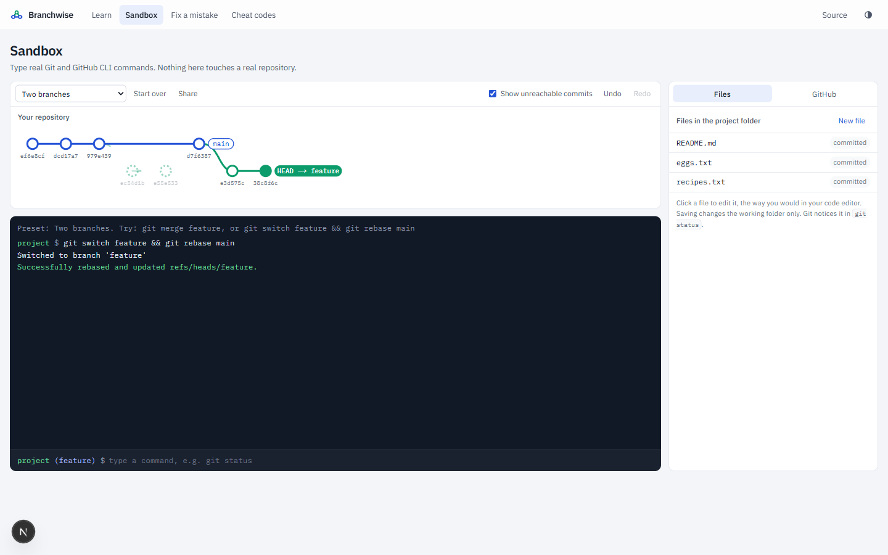
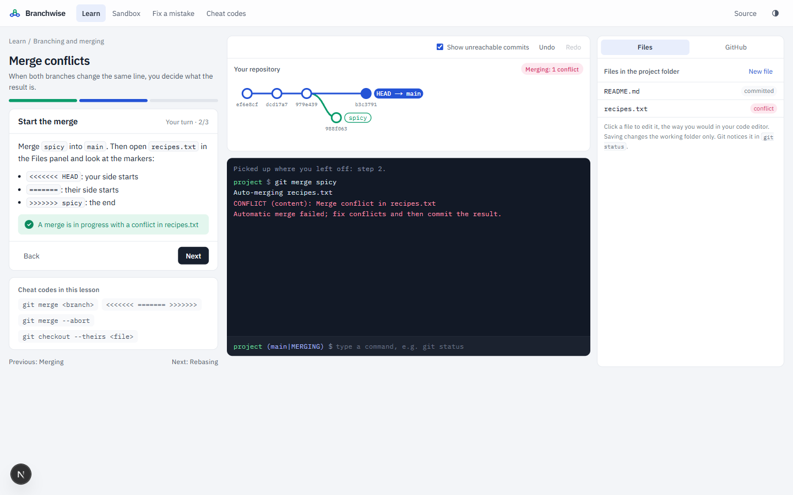

<div align="center">

# Branchwise

**An interactive way to learn Git and GitHub: every command you type redraws the commit graph.**

[](https://github.com/ohenemanaf/BRANCHWISE/actions/workflows/ci.yml)


[**Live demo**](https://branchwise-nine.vercel.app) · [Lessons](https://branchwise-nine.vercel.app/learn) · [Sandbox](https://branchwise-nine.vercel.app/sandbox) · [Cheat codes](https://branchwise-nine.vercel.app/cheats)

</div>


## Overview

Most Git tutorials ask learners to memorise commands. Branchwise shows what each command actually does. The repository is drawn as a transit map: commits are stations, branches are coloured lines and `HEAD` is the filled station. When a learner types `git rebase`, they watch their commits being copied onto a new base. When they push, they watch the commits travel to GitHub.

Everything runs in the browser against a simulated repository. There is no sign-up, no setup and no risk to real work.

## Features

| Mode | Description |
| --- | --- |
| **Learn** | 23 lessons in four modules: Git basics, branching and merging, collaborating on GitHub, and advanced Git (interactive rebase, cherry-pick, reflog, bisect, internals, submodules, GitHub Actions). Each step is either *read*, *watch* (a scripted command animates) or *try* (a goal the learner reaches, checked live against the repository's state). |
| **Sandbox** | Free practice with eight starting scenarios, including a shared team repository, a protected `main` with CI, an open-source fork and a bug hunt with `git bisect`. Supports undo/redo and shareable links that replay a session. |
| **Fix a mistake** | 12 recovery drills for common problems: committing to the wrong branch, losing work to `reset --hard`, pushing a bad commit, a stuck merge conflict, a broken rebase, a committed secret. Each one demonstrates the fix, then resets so the learner can do it themselves. |
| **Cheat codes** | A reference of 101 commands, searchable by name or by intent (for example *"undo last commit"*). Each entry carries a risk label (safe, careful, rewrites history, can destroy work) and links to the lessons that teach it. |

Progress is stored locally in the browser. The site works fully when storage is unavailable.

## How it works



### A real model of Git

`src/engine` is a self-contained TypeScript implementation of Git's data model. It has no UI dependencies and is covered by its own test suite. It supports:

- **Working state:** commits, branches, tags, `HEAD` (including detached), the staging area and working tree, the reflog, the stash and `ORIG_HEAD`
- **Combining history:** merge with line-level three-way merging (diff3) and standard conflict markers, rebase (including an interactive todo editor), cherry-pick, revert, reset (soft, mixed, hard) and bisect (including `bisect run`)
- **Remotes:** clone, fetch, pull (merge, rebase, fast-forward-only) and push, including rejected and forced pushes
- **The GitHub layer:** forks, pull requests, reviews, the three merge methods, branch protection, and Actions runs driven by the workflow file in the commit

Command output and error messages follow real Git, checked against git 2.54. Rejected pushes and *"divergent branches"* read exactly as they do in practice.

### Design decisions

- **Commands are pure functions.** `run(world, input)` returns a new world, the terminal output and a list of events. A failed command leaves the state untouched, so undo is just history.
- **Events drive the UI.** Events such as `commit`, `ref moved`, `transfer` and `conflict` drive the animations and the screen-reader announcements.
- **Hashes are deterministic.** Lesson text can refer to specific commit IDs.
- **History stays visible.** Commits that no branch points to are kept on the graph, faded, as Git keeps them. This makes reset, rebase and the reflog easier to understand.
- **The two strips line up.** The local and GitHub graphs share columns, so the same commit sits in the same place and lagging remote-tracking branches are easy to see.



## Tech stack

- **Framework:** Next.js 16 (App Router, Cache Components) and React 19
- **Language:** TypeScript
- **Styling:** Tailwind CSS 4
- **Animation:** Motion (SVG graph)
- **Testing:** Vitest (engine and content) and Playwright (end-to-end, desktop and mobile)
- **Hosting:** Vercel. CI runs on GitHub Actions.

## Getting started

Requires Node.js 24.

```bash
git clone https://github.com/ohenemanaf/BRANCHWISE.git
cd BRANCHWISE
npm install
npm run dev
```

Then open http://localhost:3000.

### Scripts

| Command | Purpose |
| --- | --- |
| `npm run dev` | Start the development server |
| `npm run build` | Create a production build |
| `npm start` | Serve the production build |
| `npm run lint` | Run ESLint |
| `npm run typecheck` | Generate route types and run the TypeScript compiler |
| `npm test` | Run the Vitest suite |
| `npm run e2e` | Run the Playwright suite against a production build (`E2E_BASE_URL` targets a deployed site) |

## Testing

| Suite | Coverage |
| --- | --- |
| Engine (70 tests) | Git behaviour scenarios: merging and conflicts, rebasing, reset and reflog recovery, stash, bisect, remotes, and the GitHub flow |
| Content (39 tests) | Walks every lesson and drill the way a learner who follows the hints would. Each goal must be unmet when its step opens and met after the model answer, so content cannot ship broken or pre-solved. Also checks that every cross-link resolves. |
| End-to-end (20 tests) | A sandbox session, finishing a lesson, a recovery drill, cheat-code search and layout overflow, on desktop and mobile viewports |

All three suites run on every pull request.

## Project structure

```
src/
├── engine/          Git model: pure TypeScript, no UI dependencies
│   ├── run.ts         Command dispatcher: run(world, input) → { world, output, events }
│   ├── repo.ts        Objects, refs, revision parsing, tree merge, status
│   ├── diff.ts        Line diff and three-way merge
│   ├── github.ts      Forks, pull requests, merge methods, protection, Actions
│   └── commands/      basics, branching, history, remote, gh, plumbing
├── viz/             Graph layout (shared columns, stable lanes)
├── components/      Graph, terminal, file and GitHub panels, rebase editor, lesson player
├── content/         Lessons, recovery drills, cheat codes and starting scenarios
└── app/             Routes: /, /learn, /sandbox, /mistakes, /cheats
```

## Scope and limitations

- **Simulated, not real.** Branchwise never touches real repositories or the GitHub API, which keeps it free and safe for beginners.
- **Partial coverage of rarely used commands.** Submodules are covered as a guided walkthrough with the core commands. A few commands, such as `git blame` and `git clean`, appear in the reference but not in the sandbox.
- **No accounts in v1.** Progress lives in the browser that made it.
